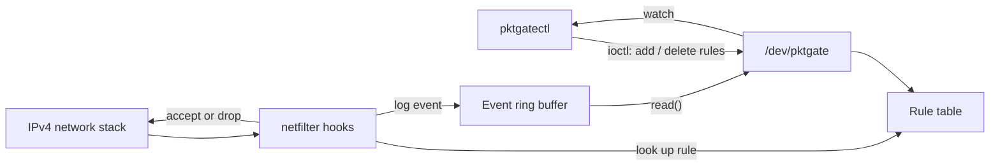

# pktgate

A small firewall that runs inside the Linux kernel.

pktgate is a loadable kernel module written in C. It looks at every IPv4 packet the machine sends or receives and decides whether to let it through, drop it or log it, based on rules you give it. You control it through a character device, `/dev/pktgate`, using a small command-line tool called `pktgatectl`.

## Quick demo

```
$ sudo pktgatectl add --out --proto icmp --dst 127.0.0.1 drop
added rule 0
$ sudo pktgatectl add --in --proto tcp --dport 22 --src 10.0.0.0/8 --log accept
added rule 1
$ sudo pktgatectl add --in --proto tcp --dport 22 drop
added rule 2
$ ping -c 2 127.0.0.1
PING 127.0.0.1 (127.0.0.1): 56 data bytes
ping: sendto: Operation not permitted
$ sudo pktgatectl list
idx dir  proto src                  dst                  sport  dport  action log hits
0   out  icmp  any                  127.0.0.1/32         0      0      drop   no  1
1   in   tcp   10.0.0.0/8           any                  0      22     accept yes 0
2   in   tcp   any                  any                  0      22     drop   no  0
$ sudo pktgatectl watch
20:09:55.659  out icmp 127.0.0.1 -> 127.0.0.1  84 bytes  drop   (rule 0) lo
^C
```

Rule 0 blocks pings to 127.0.0.1, so `ping` fails straight away. Rules 1 and 2 together allow SSH only from the 10.0.0.0/8 network. `watch` prints each matched packet as it happens.

## What it can do

- Match packets on direction (in or out), protocol (TCP, UDP or ICMP), source and destination address with a `/N` mask, and TCP/UDP port.
- The first matching rule wins. Packets that match no rule follow the default policy: accept, unless you switch it with `pktgatectl policy drop` or load the module with `policy=drop`.
- Count hits for each rule, plus totals for packets seen, accepted, dropped, logged and log events lost.
- Stream a live log of matched packets to user space. You can log only drops (the default), every packet or nothing, and turn on logging for a single rule with `--log`.
- Show the rules and counters as plain text in `/proc/net/pktgate`.
- Reject bad input, such as an invalid port or address or a full rule table, with a normal error code instead of crashing.

## How it works



1. The module registers two **netfilter hooks**: one for packets arriving at this machine and one for packets leaving it.
2. For each packet, the hook reads the addresses, protocol and ports, finds the first matching rule and returns accept or drop.
3. If the packet should be logged, the hook puts a small event record into a **ring buffer** (`kfifo`) and wakes up any reader that is waiting.
4. `pktgatectl` talks to the module through **`/dev/pktgate`**: `ioctl()` calls to manage rules and settings, and `read()` / `poll()` to receive the log.

Kernel features used: netfilter hooks, `sk_buff` header parsing, a misc character device with `ioctl`, `read` and `poll`, a `kfifo` with a wait queue, spinlocks and atomic counters, `seq_file` for `/proc`, and module parameters.

[docs/HOW_IT_WORKS.md](docs/HOW_IT_WORKS.md) walks through each part step by step, in the order a packet meets it.

## Build and run

**Use a virtual machine.** A bug in kernel code can freeze the whole system, so never load this module on your main computer. [docs/VM_SETUP.md](docs/VM_SETUP.md) shows how to set up an Ubuntu VM on a Mac or a Windows PC in about 15 minutes.

You need Linux with kernel headers, GCC and make:

```bash
sudo apt install build-essential linux-headers-$(uname -r)
```

Then:

```bash
make                                   # build the module and the tools
sudo insmod kernel/pktgate.ko          # load the module
sudo tools/pktgatectl add --in --proto tcp --dport 8080 drop
sudo tools/pktgatectl list
cat /proc/net/pktgate
sudo tools/pktgatectl watch            # Ctrl-C to stop
sudo rmmod pktgate                     # unload the module
```

Optional settings when loading: `sudo insmod kernel/pktgate.ko policy=drop event_capacity=4096`.

All `pktgatectl` commands:

```
add [--in|--out] [--proto tcp|udp|icmp] [--src A.B.C.D[/N]] [--dst A.B.C.D[/N]]
    [--sport PORT] [--dport PORT] [--log] accept|drop
del INDEX              list                 flush
policy accept|drop     log off|drops|all    stats    reset
watch [--max N] [--timeout SEC]
```

A dropped outgoing packet makes the sending program fail with "Operation not permitted". A dropped incoming packet simply never arrives, so a TCP connection to a blocked port times out.

## Tests

`sudo tests/run_tests.sh` loads the module and runs 41 checks with real TCP, UDP and ICMP traffic on the loopback interface. They cover rules in both directions, rule order and the default policy, every log mode, the event stream, bad input, counter reset, two readers at once, 100 rule changes while traffic is flowing, and a clean unload with no kernel errors.

`tests/qemu/run_qemu_tests.sh` runs the same tests inside a throwaway QEMU virtual machine. The last run, on Ubuntu's 6.8 kernel, passed all 41 checks: see [docs/test_run.txt](docs/test_run.txt).

The module also builds cleanly with the kernel's extra warnings turned on (`make W=1`).

## Why it is built this way

- **Hooks for this machine's own traffic only.** pktgate protects the sockets on this computer, so it hooks the "local in" and "local out" points. These also see loopback traffic, which lets the tests run without a network.
- **A character device for control.** `ioctl` passes typed structures both ways and returns a proper error code, and `read()` / `poll()` suit a live stream of events. Real drivers use the same pattern.
- **A ring buffer instead of `printk`.** Printing from the packet path is slow and floods the system log. If the buffer fills up, new events are counted as lost instead of slowing the network down.
- **`spin_lock_bh` around the rule table.** Packets are handled in softirq context while rule changes come from process context. Disabling bottom halves while the lock is held stops a softirq from deadlocking on a lock its own CPU already holds.

## Limitations

- IPv4 only, and only the main network namespace, so traffic inside containers is not seen.
- At most 64 rules, checked one by one.
- No connection tracking. A rule that blocks incoming packets to a port also blocks replies to connections this machine opened from that port.

## Files

```
include/pktgate_uapi.h   structures and ioctl numbers shared by the module and the tool
kernel/                  the module: init, netfilter hooks, rule table, /dev/pktgate, /proc
tools/pktgatectl.c       command-line tool
tests/                   end-to-end tests, a small TCP/UDP helper, QEMU runner
docs/                    how it works, VM setup, last test run
```

## Useful reading

- Linux kernel documentation: netfilter hooks (`include/linux/netfilter.h`), kfifo (`Documentation/core-api/kfifo.rst`), misc devices, `seq_file`
- *Linux Device Drivers*, 3rd edition (Corbet, Rubini, Kroah-Hartman): character devices, blocking I/O, concurrency
- The Linux Kernel Module Programming Guide

## License

GPL-2.0. Linux kernel modules that use GPL-only kernel functions must be GPL-licensed.
